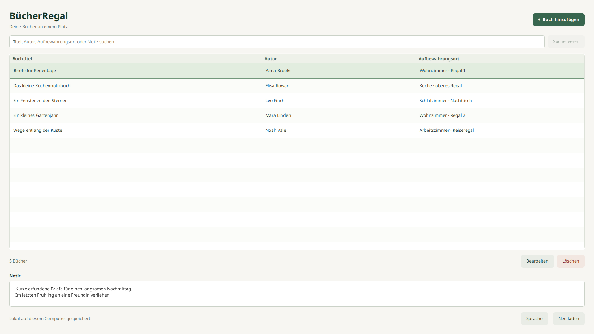

# Bookshelf

Eine kleine Desktop-App für deine eigene Büchersammlung. Erfasse Titel, Autor,
Aufbewahrungsort und eine Notiz. Finde Bücher über alle vier Felder wieder.
Die Sammlung bleibt lokal auf deinem Computer und ist nach dem Neustart erhalten.



Bookshelf ist Stufe 1 des Java-Hobby-Portfolios. Die Reihe führt über GarnBox
(Foto), StrickProjekt (Status) und NähPlan (Checkliste) bis zur fünften Stufe
KostümPlan (PDF-Export). Diese weiteren Apps bleiben eigenständige Projekte.

## Starten

Für die Entwicklung brauchst du ein **vollständiges Eclipse Temurin JDK 21.0.13+9**. `JAVA_HOME` muss auf dieses JDK zeigen. Maven wird über den
beiliegenden Wrapper bezogen. Beim ersten Build ist Internet für die
Abhängigkeiten erforderlich. Die App selbst arbeitet offline.

Die Build-Version ist app-lokal festgelegt. Maven lehnt eine abweichende
JDK-Version oder Distribution ab. Das JDK liegt auf diesem Entwicklungsrechner
unter `$HOME/.local/share/buecherregal/jdk-21.0.13+9`. Andere Apps verwenden
weiterhin ihre bisherigen Java-Installationen.

Linux und macOS, aus dem Projektverzeichnis:

```bash
export JAVA_HOME="$HOME/.local/share/buecherregal/jdk-21.0.13+9"
export PATH="$JAVA_HOME/bin:$PATH"
./mvnw javafx:run
```

Windows PowerShell:

```powershell
.\mvnw.cmd javafx:run
```

Unter Linux gibt es außerdem `./scripts/run.sh`. Der Helfer verwendet bei
fehlendem `JAVA_HOME` ein vorhandenes vollständiges JDK unter
`$HOME/.local/share/buecherregal/jdk-21.0.13+9`. Er installiert nichts und ändert keine globale Einstellung.

Das lokal erzeugte App-Image startet ohne separat installiertes Java:

```bash
'./target/app-image/Bookshelf/bin/Bookshelf'
```

## Bedienung

„Buch hinzufügen“ öffnet den Eingabedialog. Nur der Titel ist erforderlich.
Doppelklick oder Enter auf einer Tabellenzeile öffnet die Bearbeitung.
Löschen verlangt eine Bestätigung. Ungespeicherte Änderungen werden vor dem
Verwerfen abgefragt. Nach einem Speicherfehler bleiben deine Eingaben erhalten.

Ein Klick auf „Buchtitel“, „Autor“ oder „Aufbewahrungsort“ sortiert die Tabelle
alphabetisch. Weitere Klicks wechseln zwischen A–Z und Z–A. Die dauerhaft
sichtbaren Pfeile zeigen die aktive Richtung. Die Sortierung berücksichtigt
die App-Sprache und ignoriert Groß-/Kleinschreibung. Die Spalten bleiben an
ihrem Platz. Beim Start ist der Buchtitel aufsteigend sortiert.

Die gewählte Sortierung bleibt beim Suchen, Speichern, Löschen und Importieren
aktiv. Das ausgewählte Buch bleibt ausgewählt, solange es noch in der Liste
sichtbar ist. Nach dem Speichern folgt es seiner neuen Position in der Tabelle.

| Taste | Aktion |
| --- | --- |
| Strg+N / Cmd+N | Buch hinzufügen |
| Strg+F / Cmd+F | Suche fokussieren und Suchtext auswählen |
| Strg+S / Cmd+S | Dialog speichern |
| Escape | Dialog abbrechen, gegebenenfalls mit Rückfrage |
| Enter im Notizfeld | Neue Zeile |
| Entf in der Tabelle | Ausgewähltes Buch nach Bestätigung löschen |

## Sammlung exportieren und importieren

„Exportieren“ speichert die gesamte gespeicherte Sammlung als JSON-Datei.
Titel, Autor, Aufbewahrungsort und vollständige Notizen sind enthalten.
Eine aktive Suche schränkt den Export nicht ein. Vor dem Ersetzen einer
vorhandenen Exportdatei wird eine Bestätigung angezeigt.

Der vorgeschlagene Dateiname enthält Datum und lokale Uhrzeit mit Sekunden,
zum Beispiel `buecherregal-2026-10-31_09-25-00.json`. Du kannst den Namen im
Speicherdialog ändern. Der Zeitstempel wird beim Öffnen des Dialogs bestimmt.

„Importieren“ öffnet eine solche Datei und fragt vor der Übernahme nach.
Vorhandene Bücher bleiben erhalten. Identische Exemplare werden mit ihrer
Anzahl verglichen. Ein wiederholter Import derselben Datei fügt deshalb keine
weiteren Kopien hinzu. Unterschiedliche Notizen ergeben unterschiedliche Einträge.
Nach dem Import zeigt die App alle Bücher und meldet die Anzahl der hinzugefügten
und bereits vorhandenen Exemplare.

Die Datei wird vollständig geprüft, bevor Bücher übernommen werden. Bei einem
Fehler wird der gesamte Import zurückgenommen. Eine Datei darf höchstens
10.000 Bücher und 10 MiB enthalten. Die Datei funktioniert unabhängig von der
gewählten App-Sprache. Die persönliche Sprachwahl ist nicht Teil der Sammlung.
Die Schaltfläche „Neu laden“ entfällt. Nach Änderungen aktualisiert sich die
Liste weiterhin automatisch.

Neue Exportdateien funktionieren auch ohne Hardlinks, beispielsweise auf FAT32
und exFAT. In diesem Fall wird die Zieldatei exklusiv neu angelegt und der bereits
vollständige Export kopiert. Vorhandene Dateien werden dabei nicht überschrieben.
Das bestätigte Ersetzen benötigt weiterhin einen atomaren Dateiaustausch. Wenn
ein Datenträger dies nicht unterstützt, bleibt die alte Datei erhalten und ein
neuer Dateiname kann verwendet werden. Auch Netzwerk- und Cloud-Dateisysteme
können Zugriffe einschränken. Details zum Fehlerschutz stehen im Prüfbericht.

## Datenschutz

Die vollständige [englische Datenschutzerklärung](https://github.com/wasiliy-strecker/bookshelf/blob/main/PRIVACY.md) liegt als
[`PRIVACY.md`](PRIVACY.md) im eigenen GitHub-Repository. „Info“ → „Datenschutz“
öffnet genau diese Adresse im Standardbrowser, unabhängig von der App-Sprache.
Zum Lesen der Webseite ist eine Internetverbindung erforderlich. Die lokale
Sammlung wird dabei nicht übertragen. Falls der Browser nicht gestartet werden
kann, zeigt die App die Adresse zum Kopieren an.

Diese eine Datei ist die gepflegte vollständige Erklärung für App und Store.
Alle Store-Sprachen verwenden dieselbe URL. Die Menüs und Fehlermeldungen
bleiben in den sechs vorhandenen Oberflächensprachen verfügbar.

Für eine neue Übergabe den vorhandenen Elternordner und einen noch nicht
existierenden Ausgabeordner verwenden:

```bash
python3 scripts/export_privacy.py build/privacy-handoff
```

Der Helfer kopiert `PRIVACY.md` und `privacy-url.txt` ohne App-Build oder Zugriff
auf Nutzerdaten. Vorhandene Lieferungen werden nicht überschrieben.

## Sprachen

Die Oberfläche unterstützt Deutsch, Englisch, Spanisch, Französisch,
Italienisch und brasilianisches Portugiesisch. Ohne gespeicherte Sprachwahl
startet sie auf Englisch, unabhängig von der Systemsprache. Vorhandene
Sprachwahlen bleiben erhalten. Bei ausdrücklich gewähltem „Automatisch“
werden regionale Varianten wie de-AT und pt-PT der vorhandenen deutschen
beziehungsweise brasilianisch-portugiesischen Übersetzung zugeordnet.
Die deutsche Erstveröffentlichung betrifft die Store-Beschreibung, Bildtexte
und Release-Hinweise. Sie bestimmt nicht die App-Sprache.

Über „Sprache“ wählst du eine feste Sprache oder „Automatisch“ nach Systemsprache.
Die Auswahl wird nach dem nächsten App-Start übernommen. Die App startet nicht
selbständig neu. Die Sammlung und offene Buchentwürfe bleiben erhalten.
Der Markenname Bookshelf bleibt in allen Sprachen gleich.

Die Einstellung liegt in `language.txt` neben der Datenbank. Ein ungültiger
Sprachwert fällt auf Englisch zurück. Bei einem Lesefehler nutzt die App die
englische Sprache mit einem sichtbaren Hinweis. Speichern erfolgt atomar.
Ein fehlgeschlagener Schreibvorgang lässt die Auswahl im Dialog stehen.

## Daten und Tests

Die Datei `buecherregal.db` liegt unter:

| System | Verzeichnis |
| --- | --- |
| Windows | `%LOCALAPPDATA%\BuecherRegal` |
| macOS | `~/Library/Application Support/BuecherRegal` |
| Linux | `$XDG_DATA_HOME/buecherregal`, sonst `~/.local/share/buecherregal` |

Zum manuellen Sichern die App schließen und die Datenbankdatei kopieren.
Für isolierte Tests kann ein eigenes Verzeichnis angegeben werden:

```bash
./mvnw javafx:run '-Djavafx.args=--data-dir=/tmp/buecherregal-test'
```

Der normale paketierte Launcher akzeptiert direkt `--data-dir=/absoluter/testpfad`.
Ein abweichender Testpfad verändert nicht den Standardspeicherort.
Der Mac-App-Store-Build verwendet stattdessen ausschließlich seinen App-Sandbox-
Container unter `~/Library/Containers/de.appfabrik.buecherregal/Data/Library/Application Support/BuecherRegal`.

```bash
./mvnw spotless:apply
./mvnw verify
```

`verify` führt Compiler-Lint mit Warnungen als Fehlern, Maven Enforcer,
JUnit-Tests, Formatprüfung und SpotBugs aus. Die Tests verwenden temporäre
SQLite-Dateien. Es werden keine privaten Sammlungen geöffnet.

## Vorschau-Assets für den Microsoft Store

[Internationalisierung und Vorschau-Erzeugung](docs/internationalization.md)
beschreibt reproduzierbare Aufnahmen der echten Linux-Oberfläche in einem
isolierten virtuellen Bildschirm. Pro Sprache entstehen vier Bilder mit
synthetischen Büchern, insgesamt 24 Bilder in 1920 × 1080 Pixeln.

Die Klartexte in `store-listings/` sind direkt kopierbar. Jede Sprache hat eine
Beschreibung, Kurzbeschreibung, Funktionsliste und vier Bildunterschriften.
Das eigene [App-Icon](assets/branding/icon.svg) liegt außerdem als PNG und
Windows-ICO vor. Das Store-Icon hat 300 × 300 Pixel.

Diese Lieferung ist eine Linux-Vorschau. Windows-Paketierung, native Abnahme,
endgültige Windows-Store-Bilder und Einreichung bleiben separate Schritte.
Generierte Lieferungen liegen unter dem ignorierten Verzeichnis `build/`.

## Architektur und Auslieferung

Temurin 21.0.13+9, JavaFX 21.0.11 und SQLite JDBC 3.53.4.0 in einem Maven-Modul.
Die [Architekturerklärung](docs/architecture.md) erläutert den Ablauf
„Buch speichern“ und die dabei sichtbaren Java-Kenntnisse.

Die [Paketierungsanleitung](docs/packaging.md) beschreibt App-Images mit
eingebetteter Laufzeit, Windows-EXE und macOS-DMG. Für den Microsoft Store ist MSIX vorgesehen,
für den kostenlosen GitHub-Download eine EXE aus demselben Anwendungscode.
Der [MSIX-Helfer und die Windows-Abnahme](docs/microsoft-store-release.md) sind
vorbereitet. Echte Store-Identität, Windows-Ausführung und Freigabe stehen noch aus.
Die vorbereiteten GitHub-Workflows veröffentlichen keine Releases.

Der [Prüfbericht](docs/verification.md) trennt ausgeführte Prüfungen von offenen
Plattformtests. Frühere Stände wurden unter Linux geprüft. Für die jüngsten
Änderungen vor dieser Mac-Vorbereitung wurden auf Nutzerwunsch keine Tests ausgeführt. Ein älterer CI-Lauf
prüfte 33 Tests auf Windows und macOS. Native Abnahmen des aktuellen Stands
und Store-Abnahmen bleiben offen. Ein Installer ist keine geprüfte Store-Version.

Hinweise zu Fremdkomponenten stehen in [THIRD_PARTY_NOTICES.md](THIRD_PARTY_NOTICES.md).

## Erste Veröffentlichung im Mac App Store

Produktname **Bookshelf**, Version **1.0**, Build **1**.
Die erste Store-Beschreibung ist deutsch. Die Store-Vorbereitung enthält
deutsche Feldtexte, die englische Datenschutzerklärung, synthetische Beispieldaten
und Bildentwürfe.
Die [Feldanleitung](docs/mac-app-store-fields.md) beschreibt, was sich jetzt
in App Store Connect speichern lässt. Die [Mac-Anleitung](docs/mac-app-store-release.md)
führt durch Bau, native Abnahme, Signierung und die spätere manuelle Einreichung.

`scripts/macos_release.py` bereitet geprüfte Eingaben für Apple Silicon und
Intel vor. Auf macOS baut es ein gemeinsames App-Bundle mit getrennten
Laufzeiten. Native Mac-Ausführung, Sandbox-Zugriffe, Signierung und Store-Abnahme
sind hier noch nicht bestätigt. Linux-Bilder bleiben ausdrücklich Entwürfe.
Im Store-Build wählt der JSON-Export zuerst einen Ordner und danach den
Dateinamen, damit auch atomare Schreibvorgänge innerhalb der Ordnerfreigabe liegen.

```bash
python3 scripts/test_macos_release.py
python3 scripts/macos_release.py prepare --output build/mac-inputs-1.0-1
```

Die lokale Java-Verifikation und die isolierten Oberflächentests sind erneut
Bestandteil dieser Vorbereitung. Ihre konkreten Ergebnisse stehen im
Prüfbericht der jeweiligen Übergabe. Es wird nichts automatisch hochgeladen.

Eine interne Übergabe ohne Testausführung entsteht aus einem lokal committeten Stand:

```bash
python3 scripts/prepare_store_release.py build/releases/store-preparation/neuer-ordner
```

Der Ordner enthält Quellen, Store-Texte, Datenschutz, Icons, Laufzeitquellen und
die manuelle Anleitung. Er enthält kein fertiges MSIX und keine als final
ausgewiesenen Screenshots. Persönliche unversionierte Exportdateien werden
nicht übernommen. Vorhandene Ausgaben werden nicht ersetzt. Kein ZIP, Upload
oder Release. Python 3.11 oder neuer und das festgelegte JDK sind erforderlich.

## App-Icon und Ubuntu-Anwendungsmenü

Die App enthält ihr eigenes Icon für Fenster und Dialoge. Windows-Pakete verwenden
ICO, macOS-Pakete ICNS. Ubuntu ordnet das laufende Fenster über einen passenden
Anwendungseintrag demselben Icon zu.

Nach dem Linux-App-Image-Bau aus diesem App-Verzeichnis registrieren:

```bash
python3 'target/app-image/Bookshelf/install_desktop.py'
```

Danach lässt sich die App über ihren Namen in der Ubuntu-Anwendungsübersicht
starten und bei Bedarf vom Nutzer im Dock anheften. Der Installer benötigt
Python 3, keine Administratorrechte und verändert keine Sammlung.
Mit `--data-dir=/absoluter/pfad` kann der Eintrag eine bereits verwendete eigene
Sammlung öffnen. Ohne diese Option gelten die normalen Datenpfade der App.
Beim Verschieben des App-Images den Installer vom neuen Speicherort erneut
aufrufen. Einen geöffneten Prozess anschließend regulär neu starten.

## Informationen zur App

Das Menü „Info“ bietet drei getrennte Einträge. „Über die App“ zeigt den
Produktnamen, die gebaute Version, eine kurze Beschreibung und den Supportkontakt.
„Datenschutz“ öffnet die eigene englische `PRIVACY.md` auf GitHub im Browser.
„Lizenzen“ enthält die Hinweise und Originaltexte zu den Fremdkomponenten.
App-Informationen und Lizenzen sind offline verfügbar, kopierbar und schreibgeschützt.
Zum Lesen der Datenschutzerklärung auf GitHub ist eine Internetverbindung nötig.
Überschriften und Erläuterungen sind in allen sechs Sprachen vorhanden.
Rechtliche Originaltexte bleiben in ihrer Originalsprache. Weitere Hinweise
der eingebetteten Java-Laufzeit bleiben in deren Lizenzordnern erhalten.
