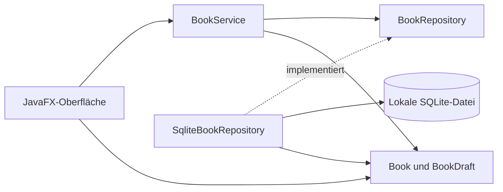

# Architektur in fünf Minuten

BücherRegal besteht aus einem Maven-Modul mit vier getrennten Bereichen.
Ein Eintrag ist klein genug für einen unveränderlichen Java-Record.
Die Oberfläche verwendet normale JavaFX-Steuerelemente und eine CSS-Datei.

| Bereich | Verantwortung |
| --- | --- |
| `domain` | `Book` mit stabiler ID und `BookDraft` mit Pflichtfeldprüfung |
| `application` | `BookService`, Speichervertrag `BookRepository`, Speicherfehler |
| `persistence` | Betriebssystemspezifischer Datenpfad, Schema und JDBC-Anweisungen |
| `ui` | Hauptfenster, Eingabedialog, Hintergrundaufgaben und Rückmeldungen |

`BooksApplication` verbindet die Komponenten über Konstruktoren. Das Modell
und die Anwendungslogik kennen weder JavaFX noch JDBC. Tests können deshalb
ohne geöffnetes Fenster ausgeführt werden. Der Speichervertrag kann sowohl
von SQLite als auch von einem gezielt fehlschlagenden Testdouble erfüllt werden.

## Beispiel: Ein Buch speichern

1. Der Dialog hält seine Texte bis zum erfolgreichen Abschluss. Ein Vergleich
   mit den ursprünglichen Texten erkennt ungespeicherte Änderungen.
2. `BookDraft` prüft den Titel, bereinigt einzeilige Felder und bewahrt die
   Formatierung der Notiz. Ein ungültiger Titel bleibt im Dialog korrigierbar.
3. `BookService.save` entscheidet anhand der ID zwischen Anlegen und Bearbeiten.
4. Ein einzelner Hintergrund-Executor führt den JDBC-Zugriff aus. Die Oberfläche
   bleibt reaktionsfähig. Die Speicherschaltfläche schützt vor Doppelaktionen.
5. Das Repository bindet Werte an ein `PreparedStatement`. SQLite führt die
   einzelne Änderung atomar aus. `try-with-resources` schließt Resultate,
   Statements und Verbindungen auch bei Ausnahmen.
6. Erst der Erfolgs-Callback auf dem JavaFX-Thread aktualisiert die Sammlung und
   schließt den Dialog. Der Fehler-Callback erhält die Eingaben und zeigt eine
   Meldung. Es gibt keinen Erfolg vor dem Datenbankabschluss.

## Entscheidungen für das Bewerbungsgespräch

Eine interne numerische ID identifiziert ein Buch unabhängig von seinem Titel.
Zwei Exemplare können gleich heißen und getrennt bearbeitet werden.
Die Repository-Schnittstelle macht diese Identität im Datenzugriff sichtbar.

Die Suche filtert die bereits geladene, kleine Sammlung mit Java-Streams.
Unicode-Normalisierung und `Locale.ROOT` sorgen für reproduzierbare Vergleiche
einschließlich Umlauten. Ein deutscher `Collator` sortiert nach Titel.
Bei gleichem Titel stabilisiert die ID die Reihenfolge. Die Arbeit ist linear
zur Textmenge der Sammlung. Eine große Bibliothek würde eine andere
Suchstrategie benötigen.

Das Repository öffnet pro Operation eine Verbindung. Der Lebenszyklus bleibt
verständlich. Eine kurze SQLite-Wartefrist behandelt vorübergehende Sperren.
Die Schema-Version liegt in `PRAGMA user_version`. Eine neuere unbekannte
Version wird abgelehnt, ohne gespeicherte Daten zu ersetzen.

Die App verwendet einen einfachen Controller-Aufbau. Records, Konstruktoren,
Interfaces, Exceptions, Collections, Streams, JDBC und JavaFX-Tasks sind an
konkreten Anforderungen sichtbar. Der Umfang bleibt klein genug, um den
gesamten Ablauf im Bewerbungsgespräch nachvollziehen zu können.

## Grenzen und Nachweis

Gleichzeitige Bearbeitung derselben Sammlung aus mehreren App-Instanzen ist
kein unterstützter Arbeitsablauf. Es gibt keine Synchronisation zwischen deren
bereits geladenen Listen. Bei Problemen weitere Fenster schließen und neu laden.

JUnit prüft Fachregeln und echte SQLite-Dateien. Der GUI-Prüfbericht ergänzt
Dialogbedienung, Abbruchschutz und die Nutzung der eingebetteten Laufzeit.
SpotBugs hat genau eine begründete Ausnahme für die absichtlich injizierte
Repository-Referenz. Sie ist auf diesen Konstruktor beschränkt.
