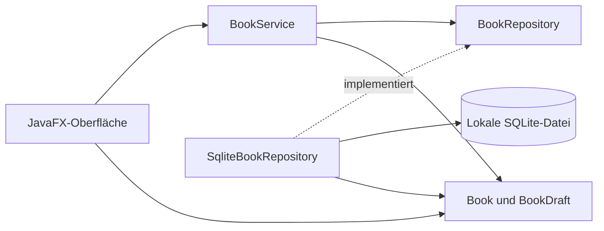

# Architektur in fünf Minuten

BücherRegal besteht aus einem Maven-Modul mit getrennten Bereichen.
Ein Eintrag ist klein genug für einen unveränderlichen Java-Record.
Die Oberfläche verwendet normale JavaFX-Steuerelemente und eine CSS-Datei.

| Bereich | Verantwortung |
| --- | --- |
| `domain` | `Book` mit stabiler ID und `BookDraft` mit Pflichtfeldprüfung |
| `application` | `BookService`, `CollectionTransfer`, Speicher- und Dateiverträge, Fehlercodes |
| `persistence` | Datenpfad, SQLite, atomarer Import und versionierte JSON-Dateien |
| `ui` | Hauptfenster, Eingabedialog, Sprachwahl, Hintergrundaufgaben und Rückmeldungen |
| `i18n` | Unterstützte Sprachen und unveränderliche ResourceBundles pro App-Start |

`BooksApplication` verbindet die Komponenten über Konstruktoren. Das Modell
und die Anwendungslogik kennen weder JavaFX noch JDBC. Tests können deshalb
ohne geöffnetes Fenster ausgeführt werden. Der Speichervertrag kann sowohl
von SQLite als auch von einem gezielt fehlschlagenden Testdouble erfüllt werden.

## Beispiel: Ein Buch speichern

1. Der Dialog hält seine Texte bis zum erfolgreichen Abschluss. Ein Vergleich
   mit den ursprünglichen Texten erkennt ungespeicherte Änderungen.
2. `BookDraft` prüft den Titel, bereinigt einzeilige Felder und bewahrt die
   Formatierung der Notiz. Ein ungültiger Titel bleibt im Dialog korrigierbar.
3. `BookService.save` entscheidet anhand der ID zwischen Anlegen und Bearbeiten.
4. Ein einzelner Hintergrund-Executor führt den JDBC-Zugriff aus. Die Oberfläche
   bleibt reaktionsfähig. Die Speicherschaltfläche schützt vor Doppelaktionen.
5. Das Repository bindet Werte an ein `PreparedStatement`. SQLite führt die
   einzelne Änderung atomar aus. `try-with-resources` schließt Resultate,
   Statements und Verbindungen auch bei Ausnahmen.
6. Erst der Erfolgs-Callback auf dem JavaFX-Thread aktualisiert die Sammlung und
   schließt den Dialog. Der Fehler-Callback erhält die Eingaben und zeigt eine
   Meldung. Es gibt keinen Erfolg vor dem Datenbankabschluss.

## Entscheidungen für das Bewerbungsgespräch

Eine interne numerische ID identifiziert ein Buch unabhängig von seinem Titel.
Zwei Exemplare können gleich heißen und getrennt bearbeitet werden.
Die Repository-Schnittstelle macht diese Identität im Datenzugriff sichtbar.

Die Suche filtert die bereits geladene, kleine Sammlung mit Java-Streams.
Unicode-Normalisierung und `Locale.ROOT` sorgen für reproduzierbare Vergleiche
einschließlich Umlauten. Ein `Collator` der gewählten App-Sprache sortiert nach Titel.
Bei gleichem Titel stabilisiert die ID die Reihenfolge. Die Arbeit ist linear
zur Textmenge der Sammlung. Eine große Bibliothek würde eine andere
Suchstrategie benötigen.

Das Repository öffnet pro Operation eine Verbindung. Der Lebenszyklus bleibt
verständlich. Eine kurze SQLite-Wartefrist behandelt vorübergehende Sperren.
Die Schema-Version liegt in `PRAGMA user_version`. Eine neuere unbekannte
Version wird abgelehnt, ohne gespeicherte Daten zu ersetzen.

Die App verwendet einen einfachen Controller-Aufbau. Records, Konstruktoren,
Interfaces, Exceptions, Collections, Streams, JDBC und JavaFX-Tasks sind an
konkreten Anforderungen sichtbar. Der Umfang bleibt klein genug, um den
gesamten Ablauf im Bewerbungsgespräch nachvollziehen zu können.

## Grenzen und Nachweis

Gleichzeitige Bearbeitung derselben Sammlung aus mehreren App-Instanzen ist
kein unterstützter Arbeitsablauf. Es gibt keine Synchronisation zwischen deren
bereits geladenen Listen. Bei Problemen weitere Fenster schließen und die App neu öffnen.

JUnit prüft Fachregeln und echte SQLite-Dateien. Der GUI-Prüfbericht ergänzt
Dialogbedienung, Abbruchschutz und die Nutzung der eingebetteten Laufzeit.
SpotBugs-Ausnahmen für absichtlich injizierte Speicher- und Dateiverträge sind
auf die Konstruktoren von `BookService` und `CollectionTransfer` beschränkt.

## JSON-Export und Import

`CollectionTransfer` verbindet `BookRepository` und den Port `CollectionFile`.
`JsonCollectionFile` verwendet die Streaming-API von Gson 2.13.2 im strikten
Modus. Der Formatbezeichner ist `bookshelf.collection`, die Version ist 1.
Jeder Eintrag enthält exakt `title`, `author`, `location` und `note` als Text.
Ungültiges UTF-8, nicht unterstützte Versionen, falsche Feldtypen, doppelte
Schlüssel und unvollständige Dokumente werden abgelehnt. Byte- und Buchlimits
verhindern unbegrenzte Dateien. IDs und Spracheinstellungen werden nicht exportiert.

Der Export liest die gesamte gespeicherte Sammlung im Hintergrund. Er schreibt
zunächst eine temporäre Nachbardatei. Erst nach vollständigem Schreiben wird
ein neues Ziel ohne Überschreiben per Hardlink veröffentlicht oder ein bestätigtes
bestehendes Ziel atomar ersetzt. Eine fehlende Dateisystemunterstützung führt
zum Fehler ohne unsicheren Fallback. Dateityp und Zielidentität werden nach der
Bestätigung erneut geprüft. Eine externe Änderung im kurzen Zeitraum zwischen
letzter Prüfung und atomarem Ersatz kann nicht vollständig ausgeschlossen werden.
App-Daten und deren Dateiverweise sind keine erlaubten Exportziele.

Der Import liest und validiert zunächst die gesamte Datei. Nach der Bestätigung
werden vorhandene Exemplare innerhalb einer SQLite-Transaktion gezählt.
Je vollständigem Textdatensatz ergänzt der Import nur die in der Datei zusätzlich
enthaltenen Exemplare. Die IDs vorhandener Bücher bleiben erhalten. Jeder
Schreibfehler rollt auch frühere Einfügungen desselben Imports zurück. Erst nach
dem Commit aktualisiert die Oberfläche die Liste und leert die Suche.
Native Dateidialoge laufen auf dem JavaFX-Thread, Datei- und Datenbankarbeit auf
dem vorhandenen Worker. Während der Übernahme verhindert die UI weitere Aktionen.

Gson-Referenz: [striktes JSON](https://google.github.io/gson/Troubleshooting.html#malformed-json-not-rejected).

## Internationalisierung

`Messages` bindet ein ResourceBundle für die beim Start gewählte Sprache.
Das englische Basisbundle ist die letzte Rückfallebene. Ein ausdrückliches
NoFallback-Control verhindert einen unbeabsichtigten Rückfall auf die
Systemsprache. UTF-8-Dateien enthalten identische Schlüssel. Apostrophe
werden als Klartext behandelt, Parameter separat in MessageFormat eingesetzt.
Zähler verwenden regionale Zahlenformate und sprachabhängige Pluralformen.
Da die App keine Datumsfelder besitzt, gibt es keine sichtbaren Datumsformate.

`StorageException.Code` trägt stabile Fehlerursachen. Das Repository erzeugt
keine übersetzten Meldungen. Erst `UiSupport` ordnet einen Code einem Text zu.
Pflichtfeldhinweise werden ebenfalls an der Oberfläche übersetzt. Eigene
Text-Kontextmenüs vermeiden gemischte Sprachen bei abweichender Systemsprache.

`LanguagePreferences` liest eine kleine Datei im bestehenden Datenverzeichnis.
Die Datei ist durch `--data-dir` vollständig von echten Nutzerdaten isolierbar.
Der Start liest sie in `Application.init` außerhalb des JavaFX-Threads.
Schreibvorgänge laufen über den vorhandenen Hintergrund-Executor und ersetzen
nur die Einstellungsdatei atomar. Die SQLite-Struktur und technische App-ID
bleiben unverändert. Eine Sprachänderung gilt erst beim nächsten Prozessstart,
sodass laufende Dialoge und asynchrone Rückmeldungen dieselbe Sprache behalten.
